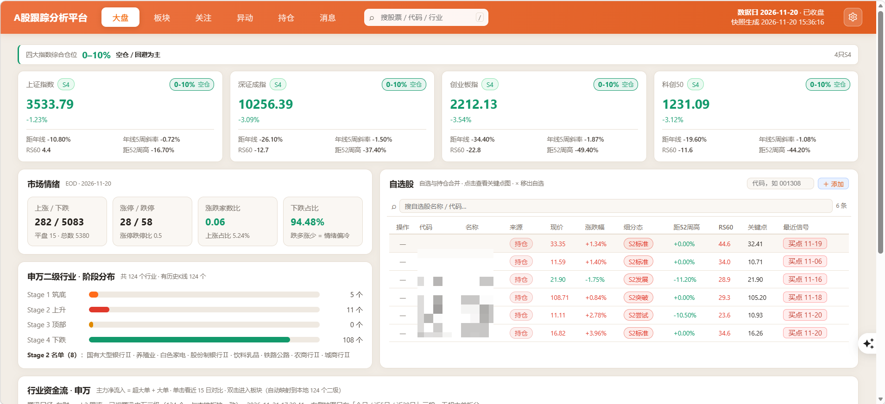
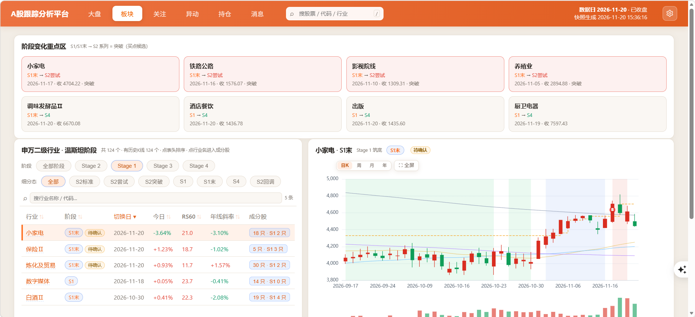
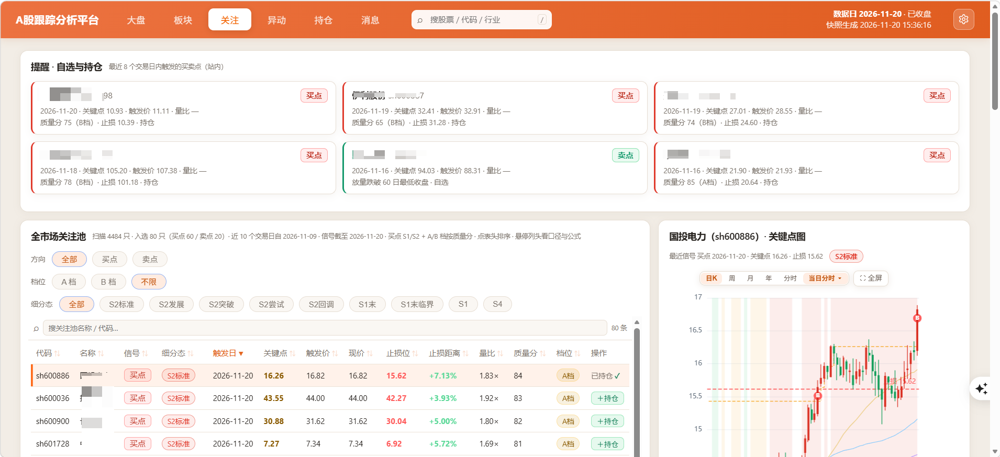
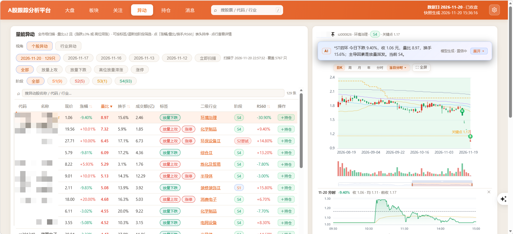
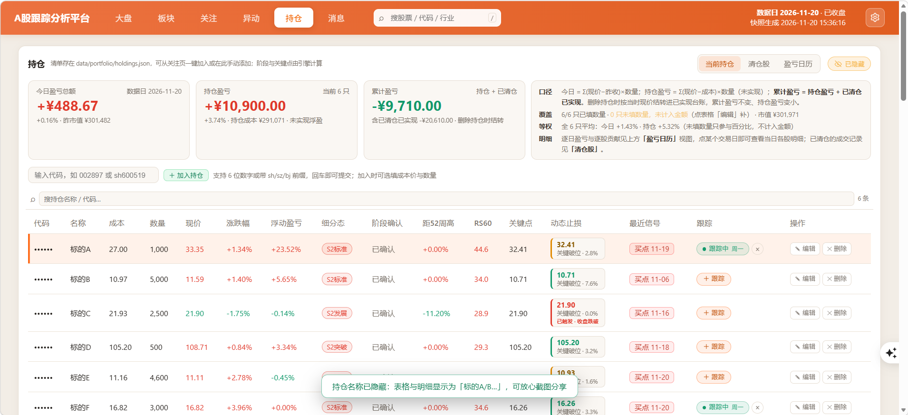
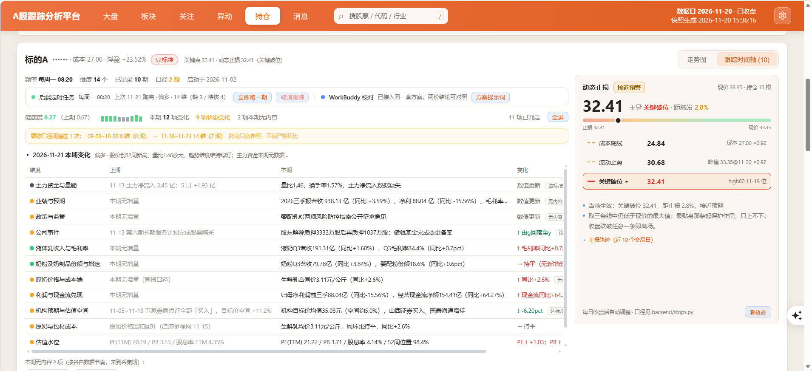

# AIStock4A · A股AI阶段跟踪研究平台

## 作为一个散户，我的感悟

我大概2013年开始入市。截止到现在，2026年，已经13年了。经历了两轮牛熊市，最大的感悟就是，作为一个普通人，不要轻易参与股市。

因为普通人，很难在A股赚到钱。哪怕你学会了各种技术指标，各种战法，但大多数人的结果都是亏钱。有些人幸运，及时离场，有些人则负债累累。

为什么A股不能让每个散户赚钱？从市场的角度来说，A股是企业融资的工具，不是让散户赚钱的地方。

从散户的角度来说，很少有散户抱着投资的想法加入A股，都是一夜暴富，都是投机。但是，大多数散户连最基本的市场逻辑都不懂，买卖股票都是靠听，靠想。听哪个人说了一嘴，这个股票好，能涨就买。靠想，买了之后就想着一直涨，哪天不涨就难受，特别是从两只中挑选一只时，选中的没涨，没选中的涨了，就开始骂。他们不知道涨的逻辑、跌的逻辑，只是靠臆想，觉得该买就买，觉得该卖就卖，没有交易纪律。

大部分散户又不愿意花钱或者时间去学习，在股市里如同赌博一样。每一次，赌个50%上涨的概率。运气差的话，可能每次买都买到下跌的那只。

同时市场是有周期的，散户又不懂仓位管理，大多是永远满仓，永远热泪盈眶。

作为散户，在A股赚钱太难了。

## 作为一个散户，我希望有个什么样的工具？

我也是从什么不懂的阶段过来的。在经过一次次碰壁亏欠之后，我就想能不能买一些工具或者学习一些理论，从而掌握住市场的A股的规律？

然后学了很多技术和指标，比如缠论、龙头战法、MCDA、RSI等一系列的理论，但到最后发现要想熟练掌握这些东西，很耗时间。就算是学会了，还不一定有效。

市面上的收费工具，要么很贵，要么很复杂。

所以我就想，能不能自己开发一个工具，不内置那么多理论和技术，只包含最直观的概念，帮助散户了解市场行情，做好仓位管理。那就成功了一半。

如果再能帮忙梳理何时的建仓机会，并能定期跟踪持仓合理性，那就更好了。

我看了很多经典书籍，最终选择了温斯坦的四阶段和利弗莫尔的关键点理论，做了这个系统。在A股最难的10月、11月进行测试，发现确实很有用。

特别是11月，整个A股市场5000多家公司，经常4000多家下跌，我的持仓还是能红。这个时候我觉得这套工具是有用的。

为了更好地完善这套工具，我决定开源出来，让更多人试用。发现问题后，大家一块修复，才能更快的完善这套工具。

## 这是什么工具？

AIStock4A，它不是选股工具！也不是致富神器！

它只是个A股数据分析软件。更确切地说，它是温斯坦四阶段 + 利弗莫尔关键点的**盘后批处理管道 + 只读查询看板**。

AIStock4A 每天收盘后会根据温斯坦的理论对A股市场4大指数、以及多个申万二级板块进行计算，得出各个板块所处阶段，并展示出来。

普通散户，可以很清晰地知道哪些板块是筑底阶段、哪些是上升阶段、哪些是滞涨阶段、哪些是下跌阶段，从而合理安排自己的仓位。比如筑底阶段0-20%，上升阶段60%-100%，滞涨阶段要减仓，仓位应该在20%-40%，下跌阶段清仓观望。

这样理论上就能吃到最肥美的阶段，也能躲过最锋利的飞刀。

知道了板块阶段后，还需要知道各个股票处于哪些阶段，这样才能真正执行到位。这个工具里也有这个功能。

不可忽视的是，买入后不是傻傻地拿着，是要动态跟踪的，要跟踪企业业绩、国内外重大事件的影响。

所以，这个工具是个从大盘到板块进行限定，缩小选择范围，再到定期检查持仓逻辑的一个分析工具。

对，是一个A股股票的分析工具。

## 功能一览

前端单页 `frontend/index.html`，6 个页签：

| 页签 | 内容 |
|---|---|
| 大盘 | 四大指数温斯坦阶段 + 综合仓位建议 + 情绪指标 |
| 板块 | 申万二级 124 板块阶段分布、行业资金流 |
| 关注 | 关注池买点/卖点候选、个股提醒卡 |
| 异动 | 量能异动扫描、证据链（公告/资金流/龙虎榜/涨停池）、AI 异动解读 |
| 持仓 | 持仓盈亏、动态止损、个股跟踪（定期 LLM 分析出期）、盈亏日历、清仓股复盘 |
| 消息 | 中美双源资讯流（中文源 + 美联储/MarketWatch/NPR 等美国权威源 RSS，英文稿自动译为中文并标注板块/个股/利多利空，无 Key 降级为固定源事实流） |

再说一遍，所有功能仅为盘面信息梳理、辅助复盘工具，**不构成任何买卖建议，股市有风险，投资需谨慎**

### 大盘
很多散户一开盘就扎进个股，分不清是普涨行情、结构性行情还是情绪退潮，经常赚了指数不赚钱、大盘跳水才后知后觉。本页面汇总全市场核心指数、涨跌家数、量能、资金、涨跌停结构，帮你快速定性当天大盘底色：市场是强是弱、赚钱效应好不好、量能是否匹配、风险有没有扩散。不用来回切换多个页面拼凑信息，开盘先看大盘定基调，再决定今天是重仓出击、轻仓试错还是空仓观望，避免逆大势操作。



### 板块
A 股最大特点就是板块快速轮动，热点一日游非常常见。这个功能跟踪全行业、题材板块的阶段趋势、资金承接、热度持续性，帮你区分：哪些板块是资金持续进场、趋势走好，进入可以耐心观察、等待低吸机会的阶段；哪些板块处于滞涨阶段，高位放量、资金出逃、利好兑现，进入风险高发区间。


### 关注
五千多只股票，普通人根本没有精力逐一复盘筛选。本页筛选出一批进入观察区间的个股，作为你的备选池。它帮你缩小选股范围，告别大海捞针式选股；机会标的只做跟踪等待买点，风险标的重点警示，管住手不去抄底飞刀，让你的选股更聚焦、更有边界。


### 异动
异动是市场资金情绪最直接的信号：突发拉板、直线跳水、大额资金抢筹、核按钮、批量炸板，都在这里集中呈现。重点用来感知当下资金的偏好、恐慌或者亢奋程度，看懂游资和短线资金当下在博弈什么、情绪有没有拐点。**明确区分：异动≠可以买入**，很多异动是诱多陷阱。它是你的情绪观测窗口，用来辅助判断当下适不适合做短线，而不是直接拿来下单，帮你戒掉看到急拉就冲动追票的习惯。


### 持仓
这是整套系统最核心的功能。汇总全部持仓的盈亏、仓位分布、成本、浮盈浮亏，直观看清账户整体状态，避免不知道自己赚在哪、亏在哪、仓位是否失衡。同时给每一只持仓建立常态化跟踪机制，自动归集、梳理持续影响个股的基本面、行业政策、订单、财报、监管、供需等利好与利空信息，定期做持仓体检。不再是买入之后就放着不管、等到大跌才去临时找利空；提前掌握变量，帮助你客观判断：是继续持有、加仓、减仓还是止损离场，摆脱 “套了就躺平、赚一点就慌着卖” 的情绪化操作。


### 跟踪
同一只股票，基本面、资金、技术面一直在变，买入时的逻辑，过一段时间可能已经失效。跟踪页面对单只标的做跨周期数据比对，把不同时间节点的趋势、资金、估值、催化信息放在一起对照，清晰看到逻辑发生了哪些变化：支撑你持仓的利好有没有兑现、有没有新增隐性利空、趋势结构有没有破坏。用来定期复盘、校验当初买入逻辑是否还成立，及时修正观点、调整交易计划，杜绝抱着旧认知硬扛行情变化，让每一笔持仓决策都有持续更新的依据。


## 快速开始

### 方式一：一键启动（Windows）

双击 `start.bat`。首次运行会自动：检查 Python → 创建虚拟环境 → 安装依赖 → 生成 `.env` → 启动服务并打开浏览器。

要求本机装有 **Python 3.10+**（安装时勾选 *Add python.exe to PATH*）。

### 方式二：手动命令

```bash
# 1. 建虚拟环境并装依赖（运行时依赖只有 fastapi + uvicorn + pydantic，
#    apscheduler 为可选，不装自动退回标准库调度后端）
python -m venv .venv
.venv\Scripts\python -m pip install -r requirements.txt -r requirements-scheduler.txt

# 2. 生成配置（默认值即可运行；想配 AI/检索 Key 见下文）
copy .env.example .env

# 3. 安装自检（离线，不联网不写数据）
cd backend && ..\tools\verify.py --offline

# 4. 启动服务
.venv\Scripts\python -m uvicorn main:app --host 127.0.0.1 --port 8000
```

浏览器打开 `http://127.0.0.1:8000/`（**必须通过服务地址访问**；`file://` 或静态预览需显式加 `?api=http://127.0.0.1:8000`，前端不兜底任何固定端口）。

### 首次使用：让系统长出自己的数据

服务启动后页面还没有数据，先跑一次盘后管道（约 10–20 分钟，多为行业成分股抓取）：

```bash
cd backend
..\.venv\Scripts\python -m jobs.eod
```

然后把你的持仓/自选填进 `backend/data/portfolio/`（仓库已内置贵州茅台等 3 只**样例持仓**，在界面里删掉换成自己的即可），再跑一次 `jobs.eod`，全站数据就有了。之后每个交易日收盘后由调度器自动跑（需 `SCHEDULER_ENABLED=1`，见 `.env.example`）。

## 配置说明

配置文件是仓库根的 `.env`（首次从 `.env.example` 复制；被 `.gitignore` 排除，永不入库）。改档位需重启服务，改 Key 不需要。

**需要填的 Key 只有两个，且都是可选**（不填也能完整运行）：

| 用途 | `.env` 变量 | 说明 |
|---|---|---|
| AI 解读 / 跟踪分析（OpenAI 兼容） | `LLM_API_KEY` / `LLM_BASE_URL` / `LLM_MODEL` | DeepSeek、通义等均可；无 Key 时 AI 解读自动退到规则版 |
| 资讯联网检索 | `SEARCH_API_KEY` / `SEARCH_API_BACKEND` | 默认 Tavily（`app.tavily.com` 免费注册，每月 1000 次）；也可 Serper 或 generic 档 |

**Key 自助配置（推荐）**：主界面右上角齿轮 → 「LLM 密钥配置」，或直接打开 `http://127.0.0.1:8000/static/config.html`。选服务商预设、粘贴密钥、保存即时生效，无需改文件重启。安全约束：页面只回 `前6…后4` 掩码，永不显示明文；密钥落 `backend/data/.secrets/`（已 gitignore）；配置接口只有 POST 且强制本机。

**检索档**（`SEARCH_PROVIDER`）：

- `llm_websearch`：LLM 服务端联网直出资讯（DeepSeek 等，按次计费一天不到 ¥1），自动按模板展开查询词、判断增量；同时直抓美联储/MarketWatch/NPR 的 RSS 补充美国权威源，英文稿由 LLM 译成中文（`US_RSS_ENABLED=0` 可关，`US_RSS_FEEDS` 可自定义源）；
- `search_api`：Tavily / Serper 自配 Key；
- `none`：零 Key 固定源（东财+新浪）事实流直出，只保证「有新闻可看」。

**资讯判断层**（`NEWS_JUDGE=1` 默认开）：LLM 先判断增量——查询词从持仓/自选 + S1/S2 行业动态生成，只收对大局或板块个股**确有增量**的新闻并标注 `sectors/stocks/codes/impact/logic`；无 Key 或全被契约拒绝时本轮不写，宁缺毋滥。`NEWS_JUDGE=0` 退回纯事实层。

其余全是档位开关（`APP_PROFILE` / `STORAGE_READ` / `SCHEDULER_*` / `PRODUCER` …），完整清单与默认值见 `.env.example`。

## 运维与监控

| 页面 | 地址 | 用途 |
|---|---|---|
| 运行监控 | `/static/ops.html` | 只读：服务健康、运行档位、Key 已配/未配（不显值）、任务运行态 |
| 调度管理 | `/static/jobs.html` | 查看固定任务、启停/改 cron/手工触发自定义任务 |
| Key 配置 | `/static/config.html` | 密钥自助配置 |

定时任务默认关闭（`SCHEDULER_ENABLED=0`），开启后支持 APScheduler / 标准库双后端、交易日历、启动追补、自定义任务热增删。`SCHEDULER_DRY_RUN=1`（默认）下只记运行记录不真抓数据，确认无误后再设 0。

## 目录结构

```
backend/
  main.py            FastAPI 服务（GET 查询 + POST 配置/操作）
  engines/           纯算法：温斯坦阶段 / 利弗莫尔关键点 / 六档记录法 / 周期聚合 / 图表装配
  datasource/        取数层：腾讯 / 东财资金流(三层降级) / 证据链 / 板块成员
  jobs/              盘后管道：eod / build_snapshot / fetch_news / news_judge / build_cases / tracking_review
  scheduler/         交易日历 / cron / 双后端调度器 / job_defs / 追补
  contracts/         digest / ai_brief / news_patch 三份 pydantic 契约 + 落盘前校验
  producers/         rule / llm_direct / agent / manual 四档解读产出
  db/                SQLite 存储层（Repository + 运行期接线，STORAGE_READ=db 启用）
  tracking_llm.py    分层取证 + LLM 定期跟踪分析 + 数字契约校验
  data_paths.py      统一数据目录解析（ASTOCK_DATA_DIR）
  config_api.py      Key 自助配置（仅本机、仅 POST、掩码回显）
frontend/            index.html 单页 + config/jobs/ops 三个运维页
tools/               verify.py 安装自检 / importer.py 导入 / verify_storage.py 对账
                     verify_scheduler.py / verify_producers.py / verify_wiring.py 等验收
docs/                SYSTEM-DESIGN.md 架构与算法详设 / NEWS-PIPELINE.md 资讯链路 / contracts/ JSON Schema
examples/            持仓/自选/日历脱敏样例
contrib/private/     私有实现覆盖层（APP_PROFILE=private 时本地加载，不发布）
```

## 存储与契约（简要）

- **文件即数据库**：默认读 JSON 文件；设 `STORAGE_READ=db` 后，启动时自举进 SQLite 并运行期替换 14 个读函数、包装 12 个写函数，算法模块源码一行不改。失败回退 files，`STORAGE_STRICT=1` 时直接抛错。MySQL/PostgreSQL 仅接口骨架，选中明确报错，不静默降级。
- **产出契约**：AI 解读与资讯 patch 必须过 pydantic 契约（`docs/contracts/*.schema.json` 由模型导出）。落盘前校验：`[依据:字段]` 必须能解析到证据、**每个数字都要能在证据包或检索来源里找到**（防编数）、买卖建议词一律拒绝、snippet 命中 prompt injection 整条拒绝。校验不过就退规则档或整条跳过，绝不静默落盘。

## 文档

| 文档 | 内容 |
|---|---|
| `docs/SYSTEM-DESIGN.md` | 架构、算法详设、数据落盘、设计决策 |
| `docs/NEWS-PIPELINE.md` | 资讯链路逐环节拆解（含排查指南） |
| `CONTRIBUTING.md` | 参与贡献须知 |
| `DISCLAIMER.md` / `NOTICE` | 免责声明与许可 |

## 免责

本项目仅用于个人研究，数据来源为公开接口，不构成任何买卖建议。见 `DISCLAIMER.md`。
