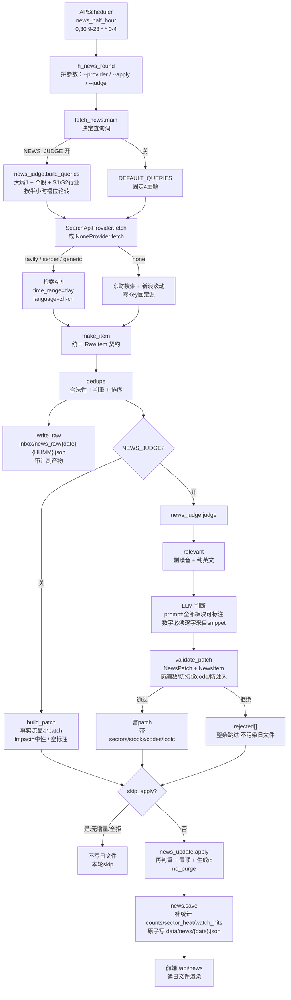

# V2 资讯检索与落盘逻辑链条

> 本文把 V2 里「搜索新闻」这件事从调度触发到前端展示的完整代码链路逐段拆开，
> 每一段都标出对应的源文件、函数、输入、输出和失败行为，并用 2026-11-20 的
> 真实一轮实测数字串讲。目标是让维护者能照着这张图定位任何一步的问题，
> 而不是只看到「跑出来了 / 没跑出来」的表象。

---

## 一、先讲清楚这条链条要解决什么问题

生产环境里，资讯质量不是靠搜索引擎堆量堆出来的，而是靠 WorkBuddy 那几个
「A股消息增量·整点/半点轮」自动化任务里的四条人工约束守住的：范围固定在
**持仓 + 自选个股 + 处于 Stage1/Stage2 的行业**；查询词固定为「A股 今日 板块
异动 原因」「`<行业名>` 最新消息」「`<个股名>` 公告」三类；Agent 逐条判断
「确有增量」才写，没增量就跳过；写进去的每条都带 `sectors / stocks / codes /
impact / logic` 结构化标注。

V2 的难点在于：内置 APScheduler 接管后，不能把「机械抓取一堆新闻直接写进日文件」
当成成功——那正是跑偏的根源。所以这条链条被拆成**事实层**和**判断层**两段：
事实层只负责抓、只产出可审计的原始条目，绝不直接写日文件；判断层复刻生产的
范围、查询词、增量判断和结构化标注，用 LLM + 契约校验把「宁缺毋滥」变成代码。
最后再交给合并器做增量去重和原子落盘。整条链的红线是：**没有判断层产出的 patch，
宁可这一轮什么都不写。**

---

## 二、全链路总览

一句话概括：调度器每半小时拉一次，事实层把公开报道抓成统一格式的 RawItem 并
留审计副本，判断层用 LLM 做增量筛选和结构化标注、再用契约校验挡掉编数和幻觉
板块，最后合并器把通过校验的条目增量写进当天日文件，前端读这份日文件渲染。

---

## 三、逐段拆解

### 第 1 段：调度触发

固定 job `news_half_hour` 定义在 `scheduler/handlers.py`，cron 表达式
`0,30 9-23 * * 0-4`，即交易日 9:00 到 23:30 之间整点和半点各触发一次；
`0-4` 是 APScheduler 口径的周一到周五（不是 Unix crontab 的 1-5），
交易日过滤由 `scheduler/core.py` 统一执行。job_type 是 `news_round`，
对应 handler `h_news_round`。这个函数只做三件事：拼参数、定检索档、定判断层开关。
检索档从 job 参数或 `SEARCH_PROVIDER` 环境变量取，默认 `none`；参数默认是
`["--provider", provider, "--apply"]`。判断层默认开——只有 `NEWS_JUDGE` 被显式
设成 `0/false/no/off` 时才关掉，关掉时回退成事实层直抓。这就是「V2 内置接管」
的入口：外部那 11 个 WorkBuddy 任务即使暂时还指着旧路径，V2 自己也在按生产的
节奏跑同一套逻辑。

### 第 2 段：查询词生成

`fetch_news.main` 决定这一轮查什么，优先级是：命令行 `--queries` 覆盖一切；
否则判断层开启时调用 `news_judge.build_queries()`；两者都没有才用固定的
`DEFAULT_QUERIES`。生产任务每轮显式搜三类词，但搜索 API 有预算约束（默认
`SEARCH_API_MAX_QUERIES=4`），所以 `build_queries()` 的做法是：大局那条
「A股 今日 板块 异动 收盘 原因」固定占 1 个名额，剩下额度按个股 6 : 板块 4
分配，再用「当前半小时槽位」（`hour*2 + 是否过半点`）做偏移轮转，让整点轮和
半点轮自然轮到不同的个股和行业，避免每轮都重复刷同一批主题。个股查询词带
`A股 {name} {code} 公告`，行业词带 `A股 {name} 板块 最新消息`——前缀和代码是
实测踩坑后加的，只写「XX科技 公告」这类简短词会被 Tavily 搜成同名 npm 包或外国公司。

### 第 3 段：事实层检索

`fetch_news.py` 用可插拔 provider 实现检索，`get_provider()` 按注册表动态加载。
`search_api` 档从 `data/.secrets/search.json` 或环境变量读配置，密钥优先级是
环境变量 > 文件，且永不进入输出；后端默认是 Tavily，请求体带
`topic=news / time_range=day / language=zh-cn`（`days` 是过时参数，`time_range`
才是当前官方写法），认证同时带 body `api_key` 和 `Authorization: Bearer` 两种
写法以兼容新旧网关。`none` 档不需要任何 Key，打东财 search-api-web 和新浪滚动
两个固定源，同一 host 本轮失败 2 次就熔断、刻意不重试——东财风控越撞越严。
所有后端产出的条目都走唯一构造入口 `make_item()`，保证标题去 HTML 标签、URL
必须是 http(s)、时间归一成 `YYYY-MM-DD HH:MM`，从而让下游 `valid_item()` 的四条
红线都能过。检索有硬性预算：`max_queries × max_results`，调用次数由脚本控制，
不交给模型决定。

### 第 4 段：去重与审计副产物

抓回来的条目先进 `dedupe()`：先用 `valid_item()` 剔除四要素不全的脏条目，再用
`is_dup()` 跟当天日文件里已有的标题和本批内已收的条目比对。判重逻辑在
`news_update.py`，URL 走规范化（去协议、去跟踪参数、保留文章 id 类参数），标题
只保留字母数字汉字做模糊比对，相似度阈值 0.86。通过的条目按时间倒序排列，再
截到 `--limit`（默认 20）。随后 `write_raw()` 把这一批原样写到
`inbox/news_raw/{date}-{HHMM}.json`——这是可审计副产物，用来回答「这一轮到底
抓到了什么」，即使判断层一条都没留，这份原始证据也在。

### 第 5 段：噪音过滤

判断层入口 `news_judge.judge()` 拿到候选后，第一件事是 `relevant()` 做保守过滤：
命中 npm / yarn / pypi / github / AMEX 等关键词的，以及标题里完全没有汉字的
纯英文条目，直接剔除。这一层只做「命中即明显无关」的剔除，拿不准的一律留给
LLM 判断，避免误杀。今天这一轮 14 条候选里剔掉了 5 条，全是 AMEX 美股财务页、
纳指盘前、AMTD Digital 这类对 A 股大局判断无用的结果。

### 第 6 段：判断层与 prompt 的两个关键分离

这是整条链最核心的一段。`judge()` 先确认有 LLM Key（`ai.config()` 读
`data/.secrets/llm.json`，OpenAI 兼容配置），没有就返回不落盘——机械抓取没有
判断层正是要避免的。然后它给 LLM 组 prompt，这里有两组范围必须分清，也是上一轮
花最多时间定位的问题：

**查询范围 vs 标注范围分离。** 检索词只从 Stage1/Stage2 行业和持仓自选里生成，
这是生产口径；但标注范围必须用 `all_sectors()` 返回的全部板块。之前把两者混用，
导致「券商股拉升」无法标到可能处于 Stage4 的「证券Ⅱ」，产出全是空标注。
现在 prompt 里给模型的「可选板块 code」是全部板块，契约校验的索引也用全部板块，
两边对齐。

**证据文本 vs 生成文本分离。** prompt 的硬约束第 0 条写明：标题以外的
summary / impact_note / logic / note 里每个数字，都必须能在该条 `sources[].snippet`
里逐字找到；snippet 没写的数字宁可写「跌幅明显」也不许补。证据正文给到 500 字
（Tavily content 上限），因为截到 400 会砍掉后半段的数字，模型凭标题印象补写就会
被防编数校验全拒。LLM 用 `producers/llm_direct.chat()` 非流式调用，超时 60 秒，
返回内容由 `_extract_json()` 容忍代码块包裹后解析成 patch。

### 第 7 段：契约校验

`validate_patch()` 是「宁缺毋滥」的执行者。顶层先用 `NewsPatch` 模型校验
date / summary / window / source_of_truth / items 的结构；然后逐条用 `NewsItem`
校验，任一条不合格就整条跳过并记录 `rejected_reason`，不污染日文件。逐条检查
包含必填字段、URL 合法性、传导逻辑 logic 非空、`sources[]` 必须存在（没有可审计
来源的分析不许落盘）、注入检测、板块和个股 code 必须在白名单索引里、数字核对、
合规词检查。数字核对 `check_numbers()` 的逻辑是：从 `sources[].snippet` 和
title 抽取所有可比对的数值构成证据集，模型文本里的每个数字都必须在证据集里
（含 1% 容差）；证据集为空时，模型文本不许出现任何数字。这一条在上一轮误杀过
「银行加码支持六张网」这类无数字新闻，后来改成「只有模型真写了数字才拒」。
今天这一轮 3 条被拒全是这条规则生效。

### 第 8 段：增量合并与落盘

通过校验的富 patch 会补上 `codes`（从 stocks 提取）和 `fetched_by=news_judge`，
然后交给 `news_update.apply()`。合并器再做一次合法性 + 判重（这次跟当天日文件
已有的条目比），把新增条目置顶、同批内按时间倒序，并生成
`inc-YYYYMMDD-HHMMSS-N` 形式的 id。它接受 `no_purge=True`，即本轮合并不顺带
清理过期文件。真正的落盘在 `news.save()`：逐条补 `category_name / impact /
horizon / confidence / keywords` 默认值，给板块标注打 `linked`、个股标注打
`in_pool`，然后聚合出三个前端要用的统计字段——`counts`（影响方向计数）、
`sector_heat`（板块热度，按提及次数和净方向排序）、`watch_hits`（自选股命中，
带相关标题）。最后原子写 `data/news/{date}.json`（先写 .tmp 再 os.replace），
前端通过 `/api/news` 读这份文件渲染。

---

## 四、每一环的输入输出与失败行为

| 环节 | 源文件 / 函数 | 输入 | 输出 | 失败时行为 |
|---|---|---|---|---|
| 调度触发 | `scheduler/handlers.py` · `h_news_round` | cron 时点 | 子进程参数 | `_guard` 去重，重复时直接跳过 |
| 查询词 | `jobs/news_judge.py` · `build_queries` | 持仓/自选/S1-S2行业 + 半小时槽位 | 最多 4 条查询词 | 候选为空时返回大局单条 |
| 检索 | `jobs/fetch_news.py` · `SearchApiProvider` / `NoneProvider` | 查询词 + 预算 | RawItem 列表 + 错误列表 | 单源失败记 error 并 break，不抛给上层 |
| 条目归一 | `jobs/fetch_news.py` · `make_item` | 各源异构字段 | 统一 RawItem | 无标题或非 http(s) URL 返回 None |
| 去重 | `jobs/fetch_news.py` · `dedupe` | RawItem + 当天已有条目 | fresh / dup / invalid | 脏条目直接剔除并计数 |
| 审计副产物 | `jobs/fetch_news.py` · `write_raw` | fresh | inbox 下的 json | 写失败只记 error，不影响 patch |
| 噪音过滤 | `jobs/news_judge.py` · `relevant` | fresh | 中文候选 + 剔除数 | 全被剔除则本轮 skip，不落盘 |
| 增量判断 | `jobs/news_judge.py` · `judge` | 候选 + LLM + 两个范围 | 富 patch 或 None | 无 Key / 调用失败 / 非 JSON：不落盘并记失败 |
| 契约校验 | `contracts/validate.py` · `validate_patch` | LLM 原始 patch + 板块索引 | 通过条目 + rejected[] | 逐条拒绝，脏条目不进日文件 |
| 跳过判定 | `jobs/fetch_news.py` · `main` | judge_info + skip_apply | 是否合并 | 无增量/全拒时 `skip_apply=True`，不写日文件 |
| 增量合并 | `jobs/news_update.py` · `apply` | patch + 当天日文件 | added / dup / invalid | 合并失败记 error，返回 ok=false |
| 统计落盘 | `news.py` · `save` | 合并后条目 | 日文件 json | 先写 .tmp 再原子替换，避免半截文件 |
| 前端消费 | `/api/news` | 日文件 | 渲染数据 | 按日期读取，无文件显示空态 |

---

## 五、开关与配置矩阵

| 配置 | 位置 | 作用 | 取值 |
|---|---|---|---|
| `NEWS_JUDGE` | 环境变量 | 判断层总开关，默认开 | `0/false/no/off` 关闭，回退事实层直抓 |
| `SEARCH_PROVIDER` | 环境变量 / 配置页 | 检索档 | `none`（零 Key 固定源）、`search_api`（付费检索）、`llm_websearch`（LLM 服务端联网，当前启用） |
| `SEARCH_API_BACKEND` | 环境变量 / 密钥文件 | 检索后端 | `tavily`（默认）、`serper`、`generic` |
| `SEARCH_API_KEY` | `data/.secrets/search.json` | 检索密钥 | 环境变量 > 文件；缺失则不检索、不报错 |
| `SEARCH_API_MAX_QUERIES` | 环境变量 | 每轮最多查几个主题 | 默认 4 |
| `SEARCH_API_MAX_RESULTS` | 环境变量 | 单主题最多取几条 | 默认 5 |
| `NEWS_JUDGE` 使用的 LLM | `data/.secrets/llm.json` | 增量判断模型 | OpenAI 兼容 base_url/api_key/model |
| `ASTOCK_DATA_DIR` | 环境变量 | 数据目录分家 | 未设=`backend/data` 默认目录；设置后服务与 CLI 子任务共用同一目录 |

密钥通过页面右上角的配置图标自助维护，接口是 `POST /api/config/state|save|test`，
只接受本机请求、只回掩码、写入 `.secrets/*.json` 即时生效；切流时这些文件要从
`backend/data/.secrets/` 复制到 `backend/data-live/.secrets/`，否则切流后 Key 会
显示「未配置」。

---

## 六、用 11-20 这轮实测数字串讲

把上面每一环套到一轮真实运行，链路的输出就不再是抽象概念：这一轮用
`.tmp-diag` 隔离目录跑（不污染正式数据目录），查询词是
`A股 今日 板块 异动 收盘 原因`、`A股 贵州茅台 sh600519 公告`、
`A股 招商银行 sh600036 公告`、`A股 国有大型银行Ⅱ 板块 最新消息` 四条。

事实层抓到 17 条，去重后 14 条（3 条重复），写进
`inbox/news_raw/2026-11-20-0723.json`。判断层的 `relevant()` 剔掉 5 条纯英文
美股噪音，剩下 9 条中文候选进 LLM。LLM 输出 5 条，其中 3 条被契约校验以
「数字 11/19 不在证据包」或「证据无数字却写了数值」为由拒绝，最终保留 2 条并
落盘到 `.tmp-diag/news/2026-11-20.json`：一条是尾盘券商股拉升、非银翻红
（标到证券Ⅱ、白色家电、广告营销等 5 个板块），一条是 3000 亿元注资特别国债
发行完成（标到国有大型银行Ⅱ、保险Ⅱ）。两条的每个标注都能在 snippet 里逐字
找到依据。这轮个股 `codes/stocks` 全空，因为搜到的个股候选只有同名公司和
行情页、没有实质增量——这符合生产「没增量就跳过」的口径，但意味着个股标注
这一环还没有正向样本验证过，切流后需要继续观察。

---

## 七、与生产任务的对齐关系

| 生产 WorkBuddy 任务的约束 | V2 的实现 | 对齐状态 |
|---|---|---|
| 范围：持仓 + 自选 + S1/S2 行业 | `focus_stocks()` + `focus_sectors()` 生成查询词 | 已对齐 |
| 查询词：大局 / 行业消息 / 个股公告 | `Q_MARKET` / `Q_SECTOR` / `Q_STOCK` 三类模板 | 已对齐，另加 A股+代码前缀消歧 |
| 增量判断：有增量才写 | `judge()` + `skip_apply`，无增量不落盘 | 已对齐 |
| 结构化标注：sectors/stocks/codes/impact/logic | 富 patch + `codes` 补齐 | 已对齐，标注范围扩至全部板块 |
| 人工阅读把关 | 契约校验 `validate_patch` 代替 | 代码化，防编数/防幻觉/防注入 |
| 每 30 分钟一轮 | cron `0,30 9-23 * * 0-4` | 已对齐 |

---

## 八、红线与已知边界

事实层绝不直接写 `data/news/` 日文件，这是从一开始就定下的红线；日文件只能由
`news_update.apply()` → `news.save()` 这条路径产出。没有判断层产出时宁可空轮，
不把机械抓取当成功。检索 API 有免费额度约束（Tavily 免费档每日调用上限），
`max_queries × max_results` 的预算设计就是为了不把额度一次性打光。所有产出都带
「不构成买卖建议」的口径说明，`source_of_truth` 和 `disclaimer` 在 patch 和落盘
两层各写一遍。

---

## 九、第三条检索档：`llm_websearch`（当前启用）

2026-11-20 起默认检索档切到 `llm_websearch`，用 LLM 服务端联网搜索直接产出过契约的 patch，
这是三档里最接近生产 WorkBuddy 任务工作方式的一档：

| 档位 | 检索执行者 | 查询词来源 | 增量判断 | 结构化标注 |
|---|---|---|---|---|
| `none` | 东财 / 新浪固定源 | 代码固定主题 | 无（事实流） | 无 |
| `search_api` | Tavily / Serper | `build_queries()` 代码轮转 | `news_judge` + LLM | 富 patch |
| `llm_websearch` | DeepSeek 服务端 | **模型按生产三类模板自行展开** | **同一模型内完成** | 富 patch |

**工作方式**：`h_news_round` 识别到该档后直接调 `jobs.news_websearch --apply`。
producer 用 `deepseek-flash`（联网工具只在这个模型上开放，与 `LLM_MODEL` 解耦，可用
`LLM_WEBSEARCH_MODEL` 覆盖）发一次带 `tools:[{"type":"deepseek_web_search"}]` 的请求；
模型自己展开「大局异动 + 每只个股公告 + 重点行业消息」的查询词、自己多轮检索、
自己判断增量并输出富 patch。结果经 `validate_patch` 校验后走同一个 `news_update.apply`
落盘。审计副本写在 `inbox/news_websearch/{date}-{HHMM}.json`，记录本轮实际搜了哪些词、
用了哪些来源、搜索次数。

**对齐生产的四个硬约束**（实测踩坑后写死，别删）：数字必须逐字来自 `sources[].snippet`，
否则契约判编数整条丢弃；`sectors`/`stocks` 必须是含 `code/name/dir/note` 的对象数组而非字符串；
`sectors[].code` 只能从全量板块清单原样复制；无 Key / 全拒时本轮不落盘。

**一轮实测（08:05）**：11 条查询词（1 大局 + 9 只持仓公告 + 1 行业），
11 次服务端搜索，保留 4 条落盘、拒 2 条编数。`codes` 能正确命中持仓个股，
`sector_heat`、`watch_hits` 统计卡正常聚合，质量与个股覆盖
均优于 `search_api` 档同期结果；被拒的 2 条是标题日期数字和 snippet 外的金额数字，
防编数护栏该拦的拦住了。

**成本**：DeepSeek 联网搜索按次计费（约 ¥5/1000 次成功请求），整点半点轮每轮 8-11 次，
一天约 18 轮、成本不到 ¥1。密钥从 `data/.secrets/llm.json` 读，
不进日志、不回显。

**检索档说明**：`SEARCH_PROVIDER` 决定检索方式——`llm_websearch`（LLM 服务端联网，
最省事）、`search_api`（Tavily/Serper 自配 Key）、`none`（零 Key 固定源降级）。
切换只改这一个变量，不影响在线 GET 路由。

### 9.1 零 Key 免费档：静默降级为事实流直出

面向不想花钱的普通用户。三档检索在 Key 缺失时的行为统一为**静默降级**，不再报错
也不再空轮——没有 Key 就没有影响判断，但客观新闻仍要能看到。

| 场景 | 行为 | 产出 |
|---|---|---|
| `llm_websearch`，无 LLM Key | 自动切到 `none` 固定源（东财 + 新浪，零 Key） | 事实流 patch，20 条上限 |
| `search_api` / `none`，无 LLM Key | 判断层 `judge()` 返回 `degraded=no_llm_key` | 事实流 patch 照常落盘 |
| 有 LLM Key | 正常走富 patch（影响判断 + 板块个股标注） | 富 patch |

降级档的 patch 由 `build_patch()` 生成：`impact` 固定「中性」、`sectors`/`stocks`/`codes`
为空、`confidence=低`，`source_of_truth` 写明「未配置 AI Key，本批次为事实流直出
（无影响判断与标注）」。因此前端统计卡会显示中性占满、板块热度和个股命中为空——
这是预期表现，不是故障。降级状态记在调度输出的 `judge_info.degraded`（页面不打扰用户，
运维日志可查），与「有 Key 但判断调用失败」严格区分：后者仍是失败。

**质量边界（如实说明）**：没有 LLM 判断层，就做不了语义级的相关性筛选，也没有影响
方向和板块标注。零 Key 档靠查询词命中和关键词过滤兜底，稿源覆盖面比带判断的两档窄，
也不会做「有增量 / 旧闻翻炒」的甄别。注意：官方媒体的世界经济、宏观经济、货币政策
报道（如美联储政策评论）是**对判断大局有价值的内容，不是噪音**——带判断的两档会保留
并写出它对 A 股大盘与外资敏感板块的传导逻辑（见第 9.2 节）。免费档缺的是这层影响分析，
而不是把宏观新闻剔除。要生产级质量仍需配 LLM Key 走 `llm_websearch`。

### 9.2 大局范围的口径：世界经济类新闻要保留

2026-11-20 修正：原先判断层 prompt 把「与 A 股无关」列为剔除项，导致官方媒体的世界经济
报道（如「美联储官员：通胀压力仍需进一步收紧政策」）可能被误杀。这类稿件即使不直接点名
A 股，也通过全球资本流动、汇率预期、外资风险偏好影响大盘估值，属于大局判断的一部分。

修正内容：两个 prompt 都把「大局判断」明确扩为国内外宏观经济、世界经济、货币政策、
海外市场；剔除项收窄为纯生活娱乐 / 量化教程 / 旧闻翻炒 / 观点博眼球 / 软文广告，并加了
「拿不准的一律保留」。`llm_websearch` 的搜索步骤也新增「世界经济 美联储 货币政策 最新」
一类查询。`relevant()` 的噪音过滤只针对 npm/github/AMEX 等技术噪音和纯英文标题，
中文宏观稿不受影响。

实测（真实 LLM 判断层）：喂入「美联储官员偏鹰表态」候选，保留成功，logic 正确写出
「偏鹰 → 全球资本流动与汇率预期 → 外资风险偏好下降 → A股估值与外资敏感板块承压」的
传导链，并标注到证券Ⅱ / 国有大型银行Ⅱ。

**11-20 实测**：模拟无 Key（`ai.config=lambda: None`），固定源抓到 56 条、去重后 20 条
事实流，降级标记 `no_llm_key`，合并器预演 20 条全部合法、不覆盖已有条目；回归
producers 48/48、degradation 8/8、assert_clean 可发布。

> 设计取舍记录（2026-11-20，用户拍板）：原先「无 Key 不落盘」的红线改为「无 Key
> 事实流直出」，这是产品定位变化——免费用户优先开箱可用，付费用户才有影响判断。
> 改动只降级资讯检索，不改 AI 解读层的「无 Key 退规则通道」，两条链路互不干扰。

### 9.3 `STORAGE_READ=db` 下的 CLI 写后同步

2026-11-20 切流后发现：`news_half_hour` 每 30 分钟都能跑，`llm_websearch --apply`
也确实把日文件从 80 条写到 83、再写到 84 条，但 8000 的 `/api/news` 仍返回 80 条。
根因不是检索或去重，而是**CLI 子进程没有安装 storage_runtime 的写后同步钩子**：
主服务启动时装了钩子，但调度是另起进程跑 `python -m jobs.news_websearch --apply`，
子进程里 `news.save()` 只落文件，没有把 `news_daily` 整表回写 SQLite；8000 又是库读，
所以页面看不到新增。

修复点在资讯写入入口：

- `jobs/news_update.py`：CLI 启动先 `env_loader.load_env()`，再
  `storage_runtime.install_from_env()`，保证 `news.save` 在 `STORAGE_READ=db` 下带写后同步；
- `jobs/news_websearch.py`、`jobs/fetch_news.py`：CLI 启动先加载 `.env`，再解析数据目录，
  避免手工运行或调度拉起时路径与档位不一致。

修复后实测：`jobs.news_update --status` 在 db 档读到 84 条，8000 `/api/news` 的
`generated_at=2026-11-20T17:00:13`、`items=84`，最新 id 为
`inc-20261120-170013-1`。回归 producers 48/48、degradation 8/8、assert_clean 可发布。

### 9.4 旧闻时效与消息列表排序

2026-11-20 17:30 之后，用户发现消息板块第一行显示 11-16。接口数据本身正常：
当日 86 条、`generated_at=17:30:12`；原因是 17:30 那轮新抓到两条发布时间较早的稿件
（11-16、11-10），`news_update.apply` 的“新增置顶”把它们放到列表最前面。
“新增”表示本轮第一次发现，不等于原文发布时间新。

两处修正：

- `jobs/news_websearch.py`：prompt 增加时效硬约束，并要求代码层复核。发布时间早于
  交易日往前两日 00:00（`2026-11-20` 对应 `2026-11-18 00:00`）的稿件，即使第一次搜到，
  也按旧闻拒绝；无法解析发布时间的同样不进 patch。`rejected[]` 会写明“按旧闻拒绝”。
- `frontend/index.html`：消息列表按 `time` 的真实时间倒序展示，不再按合并时的置顶顺序。
  这样历史批次里已经存在的旧稿也不会压在最新稿前面。

实测：时效函数把 11-20 / 11-19 判 fresh，把 11-16 / 11-10 判 stale；
新 prompt 的 dry-run 为 `ok=true`、11 次搜索、保留 5 条、数字护栏拒绝 1 条；
前端已加载 `newsTimeMs` 发布时间排序。回归 producers 48/48、degradation 8/8、assert_clean 可发布。

