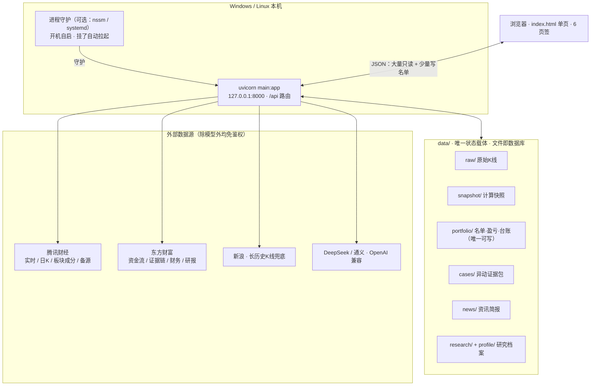
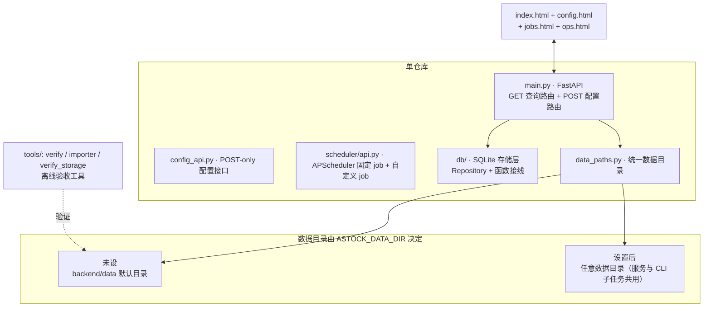

# A 股阶段跟踪系统 · 详细设计文档

> 覆盖范围：本仓库的全部模块、算法与工程能力。
> 生成时间：2026-11-19
> 取材方式：逐文件读取两个代码库的实际实现，并与历史架构底稿 `D:\code\astock-prod-architecture.md`、`D:\code\astock-refactor-plan.md` 交叉核对。所有行号对应上述两个目录。
> 用途：帮助理解决策——每个功能点的数据从哪来、怎么算、落在哪、两套环境有什么不同。

---

## 目录

- [0. 怎么读这份文档](#0-怎么读这份文档)
- [1. 系统总览与运行拓扑](#1-系统总览与运行拓扑)
- [2. 外部数据源总表](#2-外部数据源总表)
- [3. 算法层：四个引擎](#3-算法层四个引擎)
- [4. 功能逐项说明（按前端 6 个页签 + 全局功能）](#4-功能逐项说明)
- [5. EOD 盘后管道](#5-eod-盘后管道)
- [6. 工程能力总览](#6-工程能力总览)
- [7. 数据资产与落盘路径](#7-数据资产与落盘路径)
- [8. 关键参数速查表](#8-关键参数速查表)
- [9. 设计约束、脆弱点与决策清单](#9-设计约束脆弱点与决策清单)

---

## 0. 怎么读这份文档

### 一句话定性

这是一套**单机、文件即数据库、盘后批处理生成结果、前端只读查询**的个人研究平台。它不是传统 Web 应用，而是「一个每天自动跑一次的批处理管道 + 一张看板」。理解这一点，后面所有设计取舍都能对上：页面打开时几乎不联网、不计算，直接读盘后算好的结果，因此秒开、不会被上游限流拖死，代价是数据停留在昨天收盘。

### 运行形态

单机部署：FastAPI 服务只监听 `127.0.0.1`，数据目录即数据库（文件为主，可选 SQLite 读视图）。数据来源为公开行情接口；持仓/自选/跟踪方案是用户自己的数据，与本代码无关。

**核心事实：算法层与工程层严格分离。** `engines/`、`reasons.py`、`pnl.py`、`stops.py`、`store.py`、`watchstore.py`、`news.py` 等约 14 个文件是纯算法与领域逻辑，无网络 I/O；存储（SQLite）、调度、配置、数据目录、监控、契约产出等工程能力都通过运行期接线或独立模块叠加，**不改算法层源码**。本文第 3、4 章的算法说明与部署方式无关。

### 名词表

| 名词 | 含义 |
|---|---|
| `sub` / 细分态 | 温斯坦四阶段再细分的 9 种状态（如「S2 标准」「S1 末临界」） |
| `ind_pt` | 本地申万二级板块代码，形如 `pt018xxxxx`，共 124 个 |
| `BK` / `BKxxxx` | 东方财富板块代码，资金流接口的主键 |
| EOD | End of Day，盘后批处理管道 |
| 绿区文件 | 算法与领域逻辑文件，无网络 I/O，可零改动移植 |

---

## 1. 系统总览与运行拓扑

### 1.1 运行拓扑



关键事实：第三方依赖极少，只有 `fastapi` + `pydantic`，网络请求全用标准库 `urllib`，**没有 pandas/numpy/requests**。换机器只要装 Python 和 fastapi 即可运行。服务只监听 `127.0.0.1`，不对局域网开放。

### 1.2 存储与调度层



### 1.3 分层边界（两套环境通用）

```
backend/
├── engines/          纯算法层：无 I/O、无网络，只有 math
│   ├── stage.py          温斯坦 9 细分态判定树
│   ├── pivot.py          利弗莫尔关键点 / 质量分 100 分
│   ├── livermore_key.py  六档记录法（研究性，未上前端）
│   ├── periods.py        日K → 周/月/年聚合，三级历史回退
│   └── chart.py          图表 payload 装配
├── datasource/       取数层：网络 I/O，无业务判断
│   ├── base.py           DataSource 抽象类 + bar 归一化
│   ├── tencent.py        腾讯：实时 / 日K / 板块成分 / 情绪
│   ├── sectorflow.py     资金流：东财主源 + 腾讯备源 + 熔断 + 缓存
│   ├── evidence.py       异动证据链：公告/新闻/龙虎榜/资金流/分时/涨停池
│   ├── eastmoney_members.py  东财 BK → 本地 124 板块成员映射（纯离线）
│   └── tushare.py        占位（NotImplementedError，尚未接入）
├── jobs/             盘后批处理任务
├── 领域模块           research / tracking / profile / reasons / pnl / stops /
                      news / screener / search_index / ai / store / watchstore
└── data/             文件数据库（V2 可切 SQLite 读视图）
```

`engines/` 里没有一处 `import os`（除 periods 落盘缓存），`datasource/` 里没有一处业务判断。这两层是最干净的的部分，也是 V2 能原样保留算法的基础。

---

## 2. 外部数据源总表

数据源均为公开接口（早期用过的 westock-mcp OAuth 凭据 `westock_oauth.json` 已废弃，不参与读路径）+ 可选 LLM。

| 数据源 | 域名 / 接口 | 提供的数据 | 鉴权 | 稳定性与降级 |
|---|---|---|---|---|
| 腾讯实时 | `qt.gtimg.cn` | 实时价、涨跌幅、换手、量比、成交额（GBK 88 字段） | 免 | 正常，主源 |
| 腾讯日K | `web.ifzq.gtimg.cn/.../fqkline/get` | 前复权日K | 免 | 正常，主源 |
| 腾讯板块 | `proxy.finance.qq.com/.../getBoardRankList`、`rank/pt/getRank` | 板块排行、成分股、资金流备源（`hy2` 恰为 124 个申万二级） | 免 | 限流 0.05s / 熔断 45s |
| 东财 clist | `push2.eastmoney.com/api/qt/clist/get` | 资金流排行、全市场代码表、股票名称 | 免 | **曾被封**，熔断 600s |
| 东财 fflow | `push2his.eastmoney.com/.../fflow/daykline` | 板块资金流历史、个股资金流 | 免 | 曾被封，切腾讯 / 磁盘缓存 |
| 东财证据 | `push2ex.eastmoney.com/getTopicZTPool`、`datacenter-web...` 龙虎榜、`np-anotice-stock...` 公告、`search-api-web...` 资讯、`reportapi...` 研报 | 涨停池、龙虎榜、公告、新闻、财务摘要、研报 | 免 | 6 类证据里 4 类走 push2/push2his，被封时大面积失败，**无备源** |
| 新浪 | `quotes.sina.cn` | 长历史 K 线兜底（640 根） | 免 | 腾讯失败时兜底，不复权 |
| LLM | `api.deepseek.com/v1`（默认，模型 `deepseek-chat`）/ 通义 dashscope | AI 解读、多轮对话、研究档案 | **API Key** | 三档降级：pregen → LLM → 规则兜底 |

**关键口径提醒（承接前面讨论）**：

1. 板块资金流是**东财算好、系统原样搬来展示**，系统只做字段改名与板块映射，不自行计算主力/超大单。
2. 主力净流入 = 大单 + 超大单，这个定义来自东财，系统未自定义金额分档阈值。
3. 东财挂了切腾讯后，三处会变：分类篮子（496 个东财行业 → 124 个本地申万二级）、资金算法（阈值未知）、字段粒度（拆分没了，15 根柱变 3 根）。页面会用 `source` 字段明确显示「腾讯口径 / 缓存 stale」。
4. **Tushare 虽在 `datasource/tushare.py` 有占位，但未接入**；其资金流接口（`moneyflow_ind_dc` / `moneyflow_ind_ths`）是每日盘后更新，不能用于首页盘中实时资金流。

---

## 3. 算法层：四个引擎

本章算法为纯本地计算、无网络依赖，与部署方式无关。

### 3.1 阶段判定 · `engines/stage.py`

**做什么**：把一只股票（或板块指数）的 250 日 K 线映射成温斯坦四阶段，再细分为 9 种状态，让「现在处在什么阶段」从主观判断变成每天可复算的数字。

**输入**：升序日K `[{date, close, high, low, volume}]` + 基准收盘映射（默认沪深300）。

**核心公式**（`stage.py:45-90`）：

| 指标 | 公式 | 含义 |
|---|---|---|
| `MA30/60/120/250` | 简单算术平均 `_sma()` | 四档均线 |
| `slope_5w` | `(MA250 / MA250[-25] - 1) × 100` | 年线 5 周斜率，% |
| `devN` | `(close / MA(N) - 1) × 100` | 价格偏离 N 日均线，% |
| `rs60` | `chg60 - 基准60日涨幅` | 相对强度 |
| `dist52` | `(close / max(close[-250:]) - 1) × 100` | 距 52 周最高收盘，% |
| `align` | `MA30 > MA60 > MA120 > MA250` | 均线多头排列 |

**判定树**（`stage.py:93-117`）：

- `close > MA250` 时，按 `slope_5w` 分三档：
  - `> 0.3` → S2 标准（需 align 且 rs60 > 0）/ S2 发展（p ≥ MA30、MA60）/ S2 回调
  - `≥ -0.3` → S2 突破（dist52 ≥ -8 且 dev30、dev60 > 0）/ S3（dev30 < 0 且 dev60 < 0）/ S1 末临界
  - `< -0.3` → S2 尝试（dev30 > 0、dev60 > 0、chg20 > 0）/ S3
- `close ≤ MA250` 时：`p > MA120` → S1 末（dev250 > -7 且 chg20 > 0）或 S1；否则 S4。

**阈值**（`stage.py:29-34`）：`SLOPE_UP = 0.3`、`SLOPE_FLAT = -0.3`、`DIST52_NEAR = -8`、`DEV_NEAR = -7`，回看 25 日，年线 250 日。

**输出**：逐日 `sub`（9 种细分态）+ `stage`（1–4）。`confirmed_sub()`（`stage.py:152-163`）要求**连续 3 日同态**才确认，避免单日噪声。

> 注意：判定树**未使用成交量条件**，成交量只存在于输出中供其他模块使用。README 里写的「量价关系」是描述性说法，实际判定只看价格与均线。

### 3.2 关键点与质量分 · `engines/pivot.py`

**做什么**：利弗莫尔关键点突破系统——找突破位、算质量分、给买卖点与止损。

| 项 | 规则 | 位置 |
|---|---|---|
| 关键点 | 前 60 日最高收盘 | `pivot.py:115` |
| 买点 | `close > 关键点` 且 `vol ≥ 1.3 × MA50(vol)` 且 `sub ∈ S2` | `pivot.py:115-118` |
| 止损 | `关键点 − 1.5 × ATR(20)` | `pivot.py:132` |
| 假突破 | 突破后 3 日内收盘回落至关键点下方 | `pivot.py:122-126` |
| 卖点 | `close < 前60日最低` 且放量 | `pivot.py:115-148` |

**质量分 100 分**（`pivot.py:46-91`）= 收盘位置 20 + 量能强度 20 + 平台蓄势 20 + 热度催化 20 + 均线结构 10 + 风险扣分 10。档位：**A ≥ 80 / B ≥ 65 / C ≥ 50 / D < 50**。

### 3.3 六档记录法 · `engines/livermore_key.py`

研究性模块（约 359 行），把关键点按六个档位分组记录，用于离线验证报告（`jobs/build_key_report.py`），**未上前端**。

### 3.4 多周期聚合 · `engines/periods.py`

把日K 聚合成周/月/年 K 线（约 373 行），带三级历史回退。前端 `/api/chart/{code}` 的周/月/年视图由它提供。

### 3.5 图表装配 · `engines/chart.py`

约 52 行，把K线与指标装配成前端 ECharts 需要的 payload 结构。

---

## 4. 功能逐项说明

前端是单个 HTML 文件（`index.html`，约 300KB），6 个页签：大盘 `market`、板块 `sector`、关注 `focus`、异动 `moves`、持仓 `holdings`、消息 `news`。每个功能点按「做什么 / 数据来源 / 算法 / 落盘 / 接口」说明。

### 4.1 大盘页（market）

| 功能点 | 做什么 | 数据来源 | 算法 / 口径 | 接口 |
|---|---|---|---|---|
| 指数与涨跌家数 | 顶部展示大盘指数、涨跌家数、涨停数、情绪 | 指数取腾讯日K；涨跌家数/涨停取东财 `getTopicZDFenBu` + `getTopicZTPool` → `data/raw/sentiment.json` | `up_ratio = up / total × 100`；`updown_ratio = up / down`；`limit_up = max(涨跌分布第11档, 涨停池 tc)`；新高新低留 None | `GET /api/market` |
| 阶段分布 | 全市场各阶段占比 | `snapshot/market.json`（EOD ② 算好） | 逐只跑 stage.py 后按 stage 分桶计数 | `GET /api/market` |
| 行业资金流榜 | 按主力净流入排序的行业列表 | 东财 `push2.../clist/get`，`fs=m:90+t:2`（496 个板块），`fid=f62` 排序，每页 100 条翻最多 7 页；挂了切腾讯 `rank/pt/getRank` | 字段映射：`f62`→主力净额、`f184`→主力占比、`f66`→超大单、`f72`→大单、`f3`→涨跌幅；主力=大单+超大单；内存缓存 300s，磁盘缓存 `cache/sectorflow_rank.json`，熔断 600s | `GET /api/market/flow` |
| 单板块资金流历史 | 点某行业看近 15 日资金柱 | 东财 `push2his.../fflow/daykline`，`secid=90.BKxxxx` | `f52`→主力 `f53`→小单 `f54`→中单 `f55`→大单 `f56`→超大单 `f57`→主力占比 `f61`→超大占比 `f62`→收盘 `f63`→涨跌幅；腾讯 `PT` 代码退化为「今日/5日/20日」三根柱 | `GET /api/market/flow/history` |
| 东财→本地板块映射 | 把 496 个东财板块挂到 124 个本地二级板块 | 离线映射表 `flow_sector_map.json`（EOD ⑤ 每 7 天刷一次） | 优先级：① PT 代码直撞 → exact；② 名称归一化（去 Ⅰ/Ⅱ/Ⅲ）一致 → exact；③ 离线表 L1 名称一致 / L2 成分覆盖率 ≥ 0.50 归父级 / L3 成分重合最多 / L4 none。非精确标 `approx=True`，前端加 `≈` 徽标。**映射只定位、不重算金额** | `GET /api/market/flow`（attach_local） |
| 阶段切换事件 | 记录个股阶段变化的时间流 | `snapshot/transitions.json` | EOD ② 比较相邻两日 stage，变化即入流 | `GET /api/transitions` |

### 4.2 板块页（sector）

| 功能点 | 做什么 | 数据来源 | 算法 / 口径 | 接口 |
|---|---|---|---|---|
| 板块列表 | 124 个申万二级板块，筛选排序 | `snapshot/sectors.json` | EOD ② 逐板块算阶段后生成 | `GET /api/sectors` |
| 成分股下钻 | 点板块看其成分股与各自阶段 | `snapshot/members/pt*.json`（125 个文件，约 5109 只成分股） | EOD ⑥ 逐只抓 K 线算阶段，`fetch_members.py` | `GET /api/sector/{code}/members` |
| 成分股索引 | 可下钻行业清单 | `GET /api/members/index` 现场拼 | 读 members 目录 | `GET /api/members/index` |
| 板块 K 线 | 板块指数日/周/月/年图 | 腾讯日K + `engines/periods.py` 聚合 | 同个股图表 | `GET /api/chart/{code}` |

### 4.3 关注页（focus）

| 功能点 | 做什么 | 数据来源 | 算法 / 口径 | 接口 |
|---|---|---|---|---|
| 关注池 | 每日优选标的 Top N，含质量分、距关键点距离、失效位 | `snapshot/focus_pool.json`（EOD ⑦ 生成） | 综合 stage + pivot 质量分排序 | `GET /api/focus/pool` |
| 买卖信号 | 关注池个股的买点/卖点/止损信号 | `snapshot/signals.json` | pivot.py 规则：突破 + 1.3×MA50 量 + S2 → 买；破前低放量 → 卖；止损 = pivot − 1.5×ATR20 | `GET /api/signals` |
| 站内提醒 | 买卖点、破位等提醒 | `snapshot/alerts.json`（EOD ③ 内联生成） | 规则触发 | `GET /api/alerts` |

### 4.4 异动页（moves）

| 功能点 | 做什么 | 数据来源 | 算法 / 口径 | 接口 |
|---|---|---|---|---|
| 量能异动扫描 | 全市场扫描放量上攻/下跌/高位滞涨/涨停 | 腾讯实时行情 + 本地日K；结果落 `data/screener/`（保留 5 天） | 前提 `VR_MIN = 2.0`（盘后量比 = 当日量 / 前5日均量）；放量上攻 `chg ≥ 3%`；放量下跌 `chg ≤ -3%`；高位滞涨 `|chg| < 1.5%` 且 `dist52 ≥ -10%`；涨停标签 10cm `≥ 9.7%`（非 sh68/sz30）、20cm `≥ 19.7%`。**封单金额只展示、不参与判定** | `GET /api/screener`、`POST /api/screener/scan` |
| 实时行情 | 个股当日价、涨跌幅、换手、量比、成交额 | 腾讯 `qt.gtimg.cn` GBK 字段直接取，**非自算** | `chg`=f[32]、`turnover`=f[38]、`vol_ratio`=f[49]、`amount`=f[37](万元)、振幅=f[43]、成交量=f[36](手)、52周高/低=f[67]/f[68]。**内盘/外盘未实现** | `GET /api/live/{code}` |
| 分时 | 价格/均价/分钟量曲线 | 东财 `trends2/get`，30s 缓存 | 原样展示 | `GET /api/intraday/{code}` |
| 异动证据包 | 一只异动股的多源证据汇总 | 东财六源：公告 `np-anotice-stock...`、新闻 `search-api-web...`、龙虎榜 `RPT_DAILYBILLBOARD_DETAILSNEW`、资金流 `fflow/daykline`、分时 `trends2`、涨停池 `getTopicZTPool`；落 `data/cases/{date}/{code}.json` | 涨停池字段：`lbc` 连板数、`fbt` 首封、`lbt` 末封、`zbc` 炸板次数、`fund` 封单金额、`hybk` 行业 | `GET /api/ai/case/{code}` |
| 板块共振归因 | 判断异动是否板块驱动 | `reasons.py` + `industry_map()`（code→`ind_pt`，来自 members 快照 LEFT JOIN） | 同板块票 = 同日 screener 中 `ind_pt` 相同者，统计 `peer_total` / `peer_limit`；共振条件 `total ≥ 3 且 (limit ≥ 1 或 板块 chg ≥ 2%)`；权重 `w = 0.55 + min(0.2, total×0.02) + min(0.15, limit×0.05)`；反证：`total ≤ 1 且 |chg| < 1.5%` → 「非板块驱动」w=0.35 | 融入证据包 |
| AI 异动解读 | 自然语言解释异动原因 | 三通道降级：盘后预生成 `cases/{date}/ai/{code}.json` → LLM 实时 → 规则兜底 `reasons.py` | LLM：OpenAI 兼容 `/chat/completions` 流式，`temperature=0.4`，默认 `deepseek-chat`；SYSTEM prompt 要求只用证据包事实、每个判断标 `[依据:字段]`、结论/归因/反证/风险四段、≤250 字、不给买卖建议。**AI 密钥优先读本地 `llm.json`，环境变量次之** | `GET /api/ai/brief/{code}` |
| AI 多轮对话 | 就某股追问 | 同上 LLM 通道 | SSE 流式 | `POST /api/ai/chat/{code}` |

### 4.5 持仓页（holdings）

| 功能点 | 做什么 | 数据来源 | 算法 / 口径 | 接口 |
|---|---|---|---|---|
| 持仓实时视图 | 持仓股当前价与盈亏 | `snapshot/holdings.json` + 腾讯实时 | 行情视图每日重算，名单来自 `portfolio/holdings.json` | `GET /api/holdings` |
| 盈亏汇总 | 今日盈亏、累计盈亏、市值 | `pnl.py` + 实时行情 | 见下方「盈亏算法」 | `GET /api/holdings/pnl` |
| 盈亏历史/统计 | 每日盈亏曲线、月度统计 | `portfolio/pnl_daily.json`（EOD ⑧ 每日一条） | `KEEP_DAYS = 120` 历史保留 | `GET /api/holdings/pnl/history`、`/stats` |
| 增删持仓 | 手工录入成本/数量/备注 | 写入 `portfolio/holdings.json`（`store.py`，唯一可写来源） | 删除时结转已实现盈亏到 `portfolio/realized.json` | `POST/PATCH/DELETE /api/holdings` |
| 动态止损 | 三条止损线取「仍低于现价的最大值」 | `portfolio/stops.json`（`stops.py`，带 `_needs_recompute()` 脏检查） | 成本线 `cost×0.92`、滚动止盈 `持仓最高收盘×0.92`、枢轴破位线；`status`：`exit`（收盘破线）/ `warn`（距止损 < 3%）/ `hold` | 融入持仓页 |
| 个股档案 | 基本资料、财务、研报 | `profile.py`，东财 datacenter-web + 腾讯 + reportapi，24h 缓存 | 原样展示 | `GET /api/profile/{code}` |
| 研究档案 | 六章研究：证据包→三档估值→模型复述 | `research/*.md` + meta（EOD ⑨ 或前端触发生成） | 证据 hash + 公告指纹 + 30 天 TTL 三重触发重建；同样 pregen→LLM→规则 | `GET/POST /api/research/{code}` |
| 跟踪方案 | 个股跟踪计划 + 每期快照 | `tracking/{code}/meta.json` + 期数据 | 新建/改状态/频率/历史回填；注意其中操作指引文案仍写着已废弃的 `westock-mcp data_quote(...)` | `/api/tracking` 系列 |

**盈亏算法（`pnl.py:52-150`）**：

- 成本价来源：用户手工录入，**不是接口抓取**（`main.py:331` `store.add(cost=body.cost)`）。
- 昨收反推：`prev = price / (1 + chg/100)`。
- 今日盈亏：新建仓日（`added_at ≥ as_of`）用 `(price - cost) × qty`；否则用 `(price - prev) × qty`。
- 持仓盈亏：`(price - cost) × qty`；累计 = 持仓盈亏 + 已清仓已实现。
- 个股收益率：`pnl = (close / cost - 1) × 100`。
- **只统计填了数量的持仓**，没填股数不编造，避免金额合计失真。

### 4.6 消息页（news）

| 功能点 | 做什么 | 数据来源 | 算法 / 口径 | 接口 |
|---|---|---|---|---|
| 每日资讯 | 按日展示资讯简报 | `data/news/YYYY-MM-DD.json` | 纯读盘，零计算 | `GET /api/news`、`/api/news/index` |
| 资讯生成 | 检索 + 影响判断 | 多站点 RSS + LLM（WorkBuddy 自动化在 V2 外完成） | AI 不直接改日文件，只能交 patch 文件由 `news_update.py` 合并去重 | 离线，不在请求路径 |

### 4.7 全局功能

| 功能点 | 做什么 | 数据来源 | 算法 / 口径 | 接口 |
|---|---|---|---|---|
| 搜索 | 全市场代码/名称/行业搜索 | `search_index.py` 建索引 | 5 分钟进程内缓存 | `GET /api/search` |
| 健康检查 | 健康状态 + 代码新鲜度 | 读源码 mtime | `stale` 标记；V2 `boot_at` 用进程级 `BOOT_STAMP` 统一时间戳 | `GET /api/health` |
| 自选股 | 加入/删除自选 | `portfolio/watchlist.json`（`watchstore.py`） | 名单唯一可写来源 | `GET/POST/DELETE /api/watchlist` |

### 4.8 情绪与评分（贯穿大盘/异动）

- **情绪**（`tencent.py:274-328`）：腾讯无涨跌家数，借东财涨跌分布 + 涨停池合成。`up_ratio = up/total×100`、`updown_ratio = up/down`、`limit_up = max(分布档11, 涨停池 tc)`。
- **没有独立的「情绪温度计」或情绪评分模型**；只有证据置信度分档（`reasons.py:433-434`）：证据源 ≥ 6 → high，≥ 4 → medium，否则 low。
- 你自己的投资框架（Weinstein 四阶段 + 情绪温度计 + Kelly 公式 + 三情景估值）是**在头脑/外部决策层使用的**，系统本身只提供阶段、质量分、信号等事实数据，不含 Kelly 或估值模型。

---

## 5. EOD 盘后管道

### 5.1 EOD 的 9 步（`jobs/eod.py`）

| 步 | 任务 | 产出 | 依赖 | 耗时 | 失败后果 |
|---|---|---|---|---|---|
| ① | `fetch_daily` | `raw/klines.json`、`sentiment.json` | 腾讯 | 1–3 min | 降级用旧数据继续 |
| ② | `build_snapshot` | `snapshot/` 6 个 json | ① + engines | ~10 s | **管道中止（唯一硬中断）** |
| ③ | 内联 `build_alerts` | `snapshot/alerts.json` | ② + 名单 | <1 s | — |
| ④ | `build_stock_names` | `stock_names.json` | 东财 clist | ~8 s，7 天一次 | 跳过 |
| ⑤ | `build_flow_sector_map` | `flow_sector_map.json` | 东财 | ~1 min，7 天一次 | 跳过 |
| ⑥ | `fetch_members --all --force` | `members/*.json` | ⑤ | **6–10 min（算力核心）** | 保留旧快照，不中止 |
| ⑦ | `build_focus_pool` | `focus_pool.json` | ⑥ | ~7 s | 不中止 |
| ⑧ | `snapshot_pnl` | `pnl_daily.json` | ② | <1 s | 不中止 |
| ⑨ | `build_research` | `research/*` | ②⑦ + 东财 + 模型 | 首次慢 | 不中止 |

`--skip-fetch` 是离线重建模式（跳过 ①⑥⑦，避免用不回填行情的池子污染正式数据）；`--force-fetch` 用于补历史。**只有第 ② 步失败会硬中断**，其余全部降级继续——原则是「旧快照比没有快照有用」。

生产仓库**不含调度器**，只提供 `backend/run_eod.bat`，此前完全依赖 WorkBuddy 自动化触发，`StockEOD` 系统计划任务未注册，这是生产最大的单点风险。

### 5.2 自动化调度

内置 APScheduler，固定 job 见 `scheduler/handlers.py`：

| id | cron | 做什么 |
|---|---|---|
| `eod_close` | `0 16 * * 0-4` | 跑 EOD（默认 `--skip-fetch`），成功后接 pregen 链路 |
| `news_half_hour` | `0,30 9-23 * * 0-4` | 交易日 9:00-23:30 每半小时抓资讯 |
| `track_daily` | `15 16 * * 0-4` | 日频跟踪复核 |
| `track_twice_weekly` | `20 16 * * 1,3` | 周二/周四跟踪复核 |
| `track_weekly` | `25 16 * * 4` | 周五周频复核 |
| `track_quarterly` | `30 16 1 1,4,7,10 *` | 季频复核 |
| `track_event` | `35 16 * * 0-4` | 事件兜底 |

> 星期字段使用 APScheduler 口径：`0=Mon ... 4=Fri`，不是 Unix crontab 的 `1-5=Mon-Fri`。

默认 `SCHEDULER_DRY_RUN=1`（只记分录不真跑），`SCHEDULER_ENABLED=0` 时接口不可用，前端会明确提示。自定义 job 存 `job_defs` 表，分三类：新增标的不加 job、频率档按 5 个 cad 分桶、真自定义才入表。

`pregen_chain`（`handlers.py:99-132`）：读 `cases/{日}/digest.json`，缺失则 `tools.pregen export`，再跑 `build_cases --apply --producer` → 契约校验 → 落盘。尽力而为，失败不打断 EOD。

---

## 6. 工程能力总览

| 维度 | 能力 | 决策意义 |
|---|---|---|
| 存储 | SQLite 可选读视图（`STORAGE_READ=db`），文件仍是权威副本；失败回退 files（`STORAGE_STRICT=1` 抛错） | 为多端/产品化铺路，当前零侵入 |
| 读路径接线 | 运行期替换 8 张表的 14 个读函数为 `db.bridge`，包装 12 个写函数写后整表同步；**算法层模块源码不改** | 算法零风险，切换可逆 |
| 表结构 | core 7 张 `holdings/watchlist/stops/realized/tracking_plans/tracking_periods/news_daily` + `pnl_daily` + 系统 `job_runs/job_defs/schema_meta`；统一形状 `owner + 主键 + 索引列 + payload(JSON) + updated_at`，payload 为权威原文 | 索引列只用于查询 |
| 调度 | 内置 APScheduler 固定 job + 自定义 job，MemoryJobStore / coalesce / max_instances=1 / misfire=7200 | 不依赖任何外部自动化客户端 |
| 配置 | `/static/config.html` + POST-only `/api/config/state|save|test`，Key 写 `data/.secrets/*.json`，只回掩码、强制本机 | Key 自助管理，不回显明文 |
| 数据目录 | `ASTOCK_DATA_DIR` 统一解析（40 个模块收敛到 `data_paths.py`）：未设=`backend/data` 默认目录；设置后服务与 CLI 共用同一目录 | 多实例数据分家 |
| 运维页 | 静态 `ops.html`、`jobs.html`、`config.html`，主页面右上角齿轮入口；静态文件走已有 /static 挂载，不新增 GET 路由 | 页面能力不扩路由面 |
| 契约产出 | `contracts/` 三契约 + `producers/` 四档（rule / llm_direct / agent_hook / manual / discover）+ 防幻觉校验 | AI 输出可验证 |

---

## 7. 数据资产与落盘路径

### 7.1 落盘总表

| 目录 | 内容 | 可否重建 | 含隐私 |
|---|---|---|---|
| `raw/` | 标的池日K（最长 545 根） | 可（重抓） | 否 |
| `snapshot/charts/` | 个股图表缓存（~616 文件） | 可 | 否 |
| `snapshot/members/` | 124 板块 × 成分股阶段（~125 文件） | 可（~10 min） | 否 |
| `snapshot/*.json` | market/sectors/signals/focus_pool/alerts/transitions | 可（~10 s） | holdings.json 含持仓 |
| `profile/` | 个股资料+财务+研报（24h 缓存） | 可 | 否 |
| `cases/` | 异动证据包 | 可 | 否 |
| `research/` | 研究档案 md + meta | 可（慢，靠模型） | 否 |
| `intraday/` | 分时缓存 | 可 | 否 |
| `news/` | 每日资讯简报 | **不可**（含模型判断） | 否 |
| `tracking/` | 跟踪方案 + 每期快照 | 方案不可重建 | 否 |
| `screener/` | 量能异动扫描（保留 5 天） | 可 | 否 |
| `portfolio/` | 名单、止损、盈亏、已实现台账、备份 | **不可**（交易历史） | **是** |
| `data/.secrets/` | `llm.json` 等密钥 | — | **是**（严禁提交） |

**三个不可重建、必须备份的目录**：`portfolio/`（交易台账）、`tracking/`（跟踪方案）、`news/`（模型判断过的简报）。其余都可由代码 + 公开数据重新生成。

### 7.2 写路径与唯一事实来源

| 数据 | 写入方 | 读取方 | 备注 |
|---|---|---|---|
| `portfolio/holdings.json` | `store.py`（前端增删） | universe / pnl / snapshot_pnl | **唯一可写来源** |
| `snapshot/holdings.json` | `build_snapshot` | 前端持仓页 | 每日重算的行情视图，勿手改 |
| `portfolio/watchlist.json` | `watchstore.py` | 同上 | 同上 |
| `portfolio/stops.json` | `stops.py` | 持仓页 | 有脏检查 |
| `portfolio/realized.json` | `pnl.record_realized()` | 盈亏统计 | 删除持仓时结转 |
| `snapshot/*` | EOD ② | 绝大多数接口 | 全量覆盖 |
| `news/` | `news_update.py` ← AI patch | `/api/news` | AI 不许直接改日文件 |
| `research/` | `build_research` / 前端触发 | `/api/research` | 三重触发重建 |

「名单在一处、视图在另一处」是刻意的：`portfolio/` 是你手写的，`snapshot/` 是机器算的。混在一起会出现「改了成本价但止损没更新」那类 bug。

---

## 8. 关键参数速查表

| 参数 | 值 | 含义 / 位置 |
|---|---|---|
| `SLOPE_UP` / `SLOPE_FLAT` | `0.3` / `-0.3` | 年线 5 周斜率阈值，stage.py |
| `DIST52_NEAR` / `DEV_NEAR` | `-8` / `-7` | 距 52 周高点 / 均线偏离阈值 |
| 阶段确认 | 连续 3 日 | `confirmed_sub()` |
| ATR 止损 | `关键点 − 1.5×ATR20` | pivot.py |
| 买点量能 | `vol ≥ 1.3×MA50` 且 S2 | pivot.py |
| 质量分档 | A≥80 / B≥65 / C≥50 | pivot.py |
| `VR_MIN` | `2.0` | 异动扫描量比门槛 |
| 涨停阈值 | 10cm ≥9.7% / 20cm ≥19.7% | screener.py |
| 共振条件 | `total≥3 且 (limit≥1 或 chg≥2%)` | reasons.py |
| 资金流缓存 | 内存 300s / 磁盘 json / 熔断 600s | sectorflow.py |
| 分时缓存 | 30s | main.py |
| 搜索缓存 | 5 min | search_index.py |
| `KEEP_DAYS` | 120 | 盈亏历史保留天数 |
| 证据置信 | ≥6 high / ≥4 medium / 其他 low | reasons.py |
| LLM temperature | `0.4` | ai.py，≤250 字 |
| EOD cron（V2） | `0 16 * * 0-4` | eod_close（APScheduler 0=Mon） |
| 交易日历 | `scheduler/calendar.py` | 判断交易日、快照日 |

---

## 9. 设计约束、脆弱点与决策清单

### 9.1 八条设计约束（资产，动架构时不能丢）

1. **离线生成、在线读取**：研究档案、AI 解读全部盘后生成，请求路径绝不调模型。
2. **快照与实时视图分离**：`portfolio/` 是名单，`snapshot/` 是行情视图，两者不混写。
3. **页面秒开优先于数据新鲜度**：宁可显示昨天收盘，也不让页面等上游接口。
4. **每个数据源都要有降级路径**：资金流已实现三层（东财 → 腾讯 → 磁盘缓存），证据链尚未。
5. **交易日基准 ≠ 自然日**：`chg` 属于哪个交易日由 K 线末根日期决定，不是 `datetime.now()`。
6. **AI 只复述证据**：`reasons.py` 先算出带数字的因果链与反证，模型只负责讲顺，不许新增事实、不许给买卖建议。
7. **只统计填了数量的持仓**：没填股数不编造。
8. **名单以文件为准**：`universe.py` 从 `portfolio/*.json` 读，不写死在代码里。

### 9.2 脆弱点

| 级别 | 问题 | 影响 |
|---|---|---|
| 高 | 盘后链路依赖调度器在线（已内置 APScheduler 解决） | 调度不在线 → 当天无快照 → 全站数据停在昨天 |
| 高 | `evidence.py` 六类证据中四类走被封的 push2/push2his，无备源 | 东财封禁时异动页证据链失效 |
| 高 | 首页资金流盘中限流 | 多实例各自抓东财、缓存不共享，同一榜单被抓多遍（详见「数据源」章） |
| 中 | 单进程、无鉴权、无 HTTPS | 只听 127.0.0.1 所以安全；一旦对外暴露即全开 |
| 中 | 文件即数据库、无事务 | 并发写同名 json 可能互覆盖（靠原子写 + 单用户规避） |
| 中 | `snapshot/` + `charts/` 全量重算约 10 分钟 | 出问题只能整体重跑 |
| 低 | `tushare.py` 是占位、`tracking.py` 有废弃文案、`westock_oauth.json` 遗留 | 技术债，不影响当前运行 |

### 9.3 留给你判断的决策点

1. **要不要保持单机文件架构？** 零运维、可直接拷走；但无法多端同步、无法给别人用。产品化就得换数据库（本仓库的 SQLite 读视图是过渡方案）。
2. **调度放哪？** 已内置 APScheduler；如需更强可对接外部任务系统。
3. **东财依赖怎么处置？** 证据链要不要像资金流那样加备源，还是接受「东财不可用时异动页降级」。首页限流的工程解法是**跨实例共享缓存 + 降频**，而不是换 Tushare（Tushare 盘后更新，会牺牲盘中实时）。
4. **不可重建资产备份**：`portfolio/`、`tracking/`、`news/` 三处要有定期备份策略。
5. **资讯检索质量（2026-11-20 改造）**：内置 `backend/jobs/news_judge.py` 判断层：动态查询词对齐三类模板（大盘异动 / `<行业>`最新消息 / `<个股>`公告）、LLM 只收有增量新闻、复用 `NewsPatch` 契约校验（幻觉板块/编数字被拒）、无 Key 或全被拒时不落盘，产出带 `sectors`/`stocks`/`codes`/`logic` 的富 patch，仍走 `news_update.apply` 去重合并。调度器 `h_news_round` 默认加 `--judge`（`NEWS_JUDGE=0` 可退回纯事实层）。实测：真实 Key 下煤炭新闻被正确标注到"煤炭开采"板块、impact=分化；48/48 + 37/37 回归全绿。

---

*本文档只描述现状与差异，未修改任何代码或数据。如需某一功能点的更深层代码细节，按文中标注的文件:行号查阅即可。*
